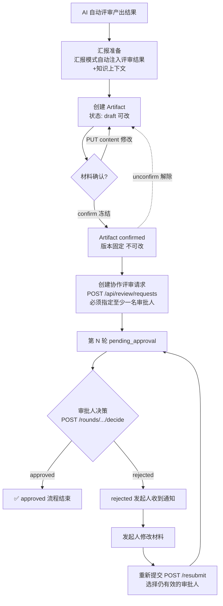
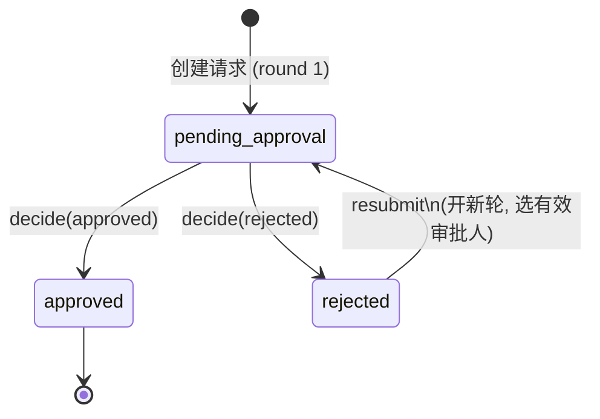
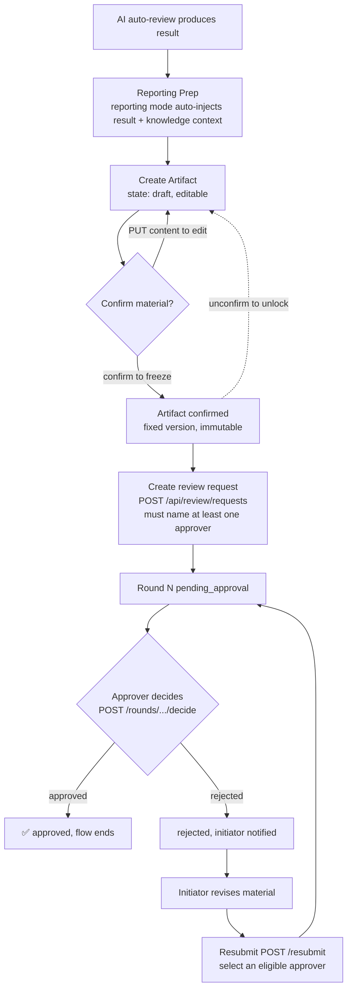
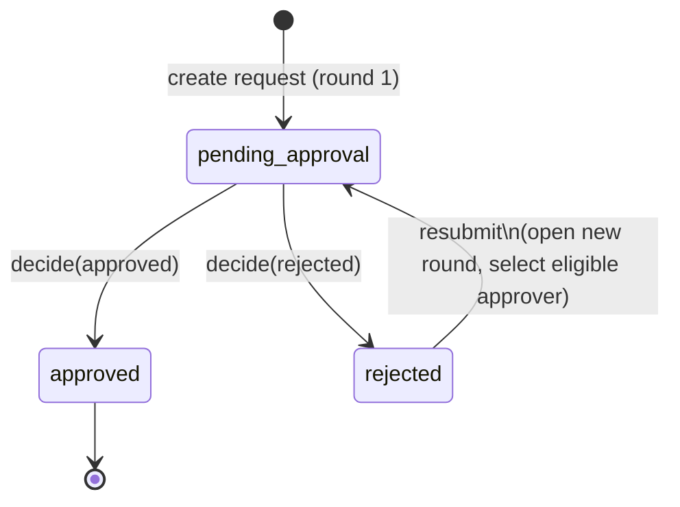

# 协作评审 / Collaborative Review

<p align="center">
	<a href="#中文"><strong>中文</strong></a>
	<span> | </span>
	<a href="#english"><strong>English</strong></a>
</p>

<a id="中文"></a>

## 中文

本文档面向**评审参与者**(评审人、审批人、发起人),讲解「AI 需求评审工作流平台」的**协作评审(P4)**能力。

> 协作评审是 AI 自动评审之后的高级阶段。如果你还不熟悉基础的「上传 DOCX → AI 自动评审」流程,请先阅读 [user-guide.md](user-guide.md)。

### 1. 它解决什么问题

传统线下评审的痛点是:AI 评审产出了结果,但**人是断层的**——评审结论发到群里,谁该拍板不清楚;改了一版,上一版对没对齐没人记得;审批人看得到结论却没责任边界。

协作评审把人正式纳入流程,形成闭环:

**汇报准备(AI 评审产出)→ 材料确认(Artifact 冻结)→ 协作评审(多轮审批 + 评论 + 通知)**

这三步是理解全文的钥匙:

| 阶段 | 谁在做 | 产出 | 状态含义 |
|------|--------|------|----------|
| **汇报准备** | AI(汇报模式自动注入评审结果和知识上下文) | 可呈现的汇报材料(Artifact,初始为 `draft`) | 内容可改 |
| **材料确认** | 发起人 / Reviewer / Approver / 项目管理员 | 冻结(frozen)的 Artifact,版本固定 | 内容锁定,不可改 |
| **协作评审** | 审批人(可决策)+ Reviewer(可评论)+ Observer(只读) | 审批决定 + 评论 + 通知 | 以「轮次」为单位推进决策 |

建议先确认冻结材料，再进行协作评审，让审批人围绕确定的内容讨论。材料冻结由 Artifact 的 `confirm` 操作控制。

### 2. 整体流程图



协作评审以**轮次（Round）**为单位决策。轮次模型提供可选的快照和材料引用字段，当前创建与重新提交接口只登记轮次及审批人，两个引用字段默认为空。材料确认与知识快照需要分别通过对应接口管理。

### 3. 协作评审请求(ReviewRequest)

#### 3.1 创建请求

```
POST /api/review/requests
```

请求体:

```json
{
  "project_id": 12,
  "approver_ids": [42],
  "goal": "确认 P4 协作评审方案是否可进入开发"
}
```

**关键规则**:

- **必须指定至少一名审批人(`approver_ids` 必填、非空)**。否则返回 `422`「至少指定一名审批人」。
  > 这是 **BUG-084** 的修复:早期版本允许创建一个「无人审批」的请求,导致流程卡死、永远无人能拍板。
- 只有**项目创建者**能发起协作审查;否则 `403`「只有项目创建者可以发起协作审查」。
- **审批人必须满足**:是项目所在 workspace 的活跃成员、具备 `write` 权限，且**不能是发起人本人**。用户不存在、全局账号禁用或指定本人审批时返回 `422`；非空间成员、空间成员停用或角色无写权限时返回 `403`。发起人停用或降为 `viewer` 后也不能再发起。
- 创建后:自动开第 1 轮(`round_no=1`)、把发起人加为 `Reviewer`、把审批人加为 `Approver`,请求状态变为 `pending_approval`。
- 审批人会收到一条**实时通知**(采用 `defer_push`:数据库提交成功后才推送,避免「幽灵通知」**BUG-106**)。

#### 3.2 查询

| 端点 | 说明 |
|------|------|
| `GET /api/review/requests?project_id=...` | 先校验项目可见性。活跃项目创建者及 workspace owner/admin 可查询；普通非创建者即使是参与者，也不能使用此项目列表入口，可使用请求详情入口 |
| `GET /api/review/requests/{request_id}` | 请求详情 |

### 4. 多轮审批(核心)

协作评审可以**多轮来回**。每一轮是一个 `ReviewRound`，记录指定审批人和决策结果，并提供可选的提交快照与材料引用字段。

#### 4.1 轮次与决策

| 端点 | 说明 |
|------|------|
| `GET /api/review/requests/{request_id}/rounds` | 该请求的所有轮次 |
| `POST /api/review/rounds/{round_id}/decide` | 审批人做决策 |

决策请求体:

```json
{ "decision": "approved", "comment": "方案明确,可以进入开发" }
```

`decision` 只能是 `approved` 或 `rejected`(非法值返回 `422`)。已决策过的轮次不能再改(`400`「轮次已决策」)。

#### 4.2 审批权限校验(重点)

不是任何参与者都能做决策,系统按以下顺序校验:

1. 当前用户必须是项目所在 workspace 的**活跃 `write` 成员**;否则 `403`。
2. **发起人不能批准自己的协作审查请求**;存量数据把发起人写成 `approver_id` 时也返回 `403`。
3. 当前用户必须是该请求的 **active `Approver` 参与者**;若已被停用、移出空间或降为 `Reviewer`/`Observer`,返回 `403`。仅对尚未写入参与者行的极旧数据保留“指定 `approver_id`”兼容。
4. workspace `owner` / `admin` 仍需满足活跃成员条件,但不会被“必须是项目创建者”的可见性规则误伤。

决策结果会同步更新请求状态:`approved` → 请求 `approved`;`rejected` → 请求 `rejected`,并通知发起人。

#### 4.3 重新提交(resubmit)

被驳回后,发起人修改材料可重新提交,**开新轮次**:

```
POST /api/review/requests/{request_id}/resubmit
```

规则:

- 只有 `rejected` 状态的请求可重新提交(`400`「只有被驳回的请求可以重新提交」)。
- 只有**发起人**能重新提交(`403`「只有发起人可以重新提交」)。
- 发起人必须仍具备 workspace 活跃成员的 `write` 权限。系统按历史轮次从新到旧、再到当前 active `Approver` 参与者的顺序查找有效独立审批人，跳过停用、降权或属于发起人本人的候选者。
- 优先沿用仍然有效的上一轮 `approver_id`。找不到有效审批人时返回 `422`「原审批人已停用或无权审批,请先添加有效审批人」，请求保持驳回状态。
- 状态重新置为 `pending_approval`,并通知审批人(同样使用 `defer_push`)。

#### 4.4 多轮状态流转



> 设计要点:**轮次是审批的最小决策单位,请求是流程的聚合单位**。一个请求可以经历多轮,每轮独立决策;只要任意一轮 `approved`,整个请求即 `approved`。

### 5. 参与人管理(Participant)

协作评审围绕「参与者 + 角色」组织权限。

| 端点 | 说明 |
|------|------|
| `GET /api/review/requests/{request_id}/participants` | 参与者列表 |
| `POST /api/review/requests/{request_id}/participants` | 添加参与者(仅发起人或项目创建者) |

三种角色:

| 角色 | 能力 | 典型场景 |
|------|------|----------|
| **Observer** | 只读,不可写、不可确认 | 仅需知会的相关方 |
| **Reviewer** | 可写、可评论、可确认材料 | 一起打磨方案的人 |
| **Approver** | 可写、可确认、**可做审批决策** | 拍板的人 |

补充：发起人、项目创建者须保有 workspace 写权限才能修改或确认。其他成员按参与者角色校验，显式 `Observer` 或 inactive 参与者会优先被拒绝，workspace admin/owner 也适用；未被这样限制的活跃 admin/owner 可写、可确认。`role` 必须是 `Reviewer`/`Approver`/`Observer` 之一，否则 `422`。添加参与者时，目标用户必须是该 workspace 的活跃成员；不能把发起人添加为 `Approver`。评论的发表、删除、解决均要求对象写权限（删除还要求作者本人）。

### 6. 对象级访问与权限拆分(安全重点)

协作评审的权限不是「登录就能用」,而是基于**对象级访问控制**,做到读 / 写分离。详见 [security.md](security.md)。

#### 6.1 读写分离

- **读(read)** vs **写(write)** 拆开校验:同一对象,有的角色只能看、有的能改。
- **Observer 是只读**:不可写、不可确认材料。系统会**阻止只读角色(Observer / 空间 viewer)篡改内容**。
- 发起人、项目创建者及 active Reviewer/Approver 在具备 workspace 写权限时可写、可确认。其他 workspace admin/owner 的写权限还受显式参与者角色与状态限制。

#### 6.2 BOLA 防护

- **BOLA**(Broken Object-Level Authorization,对象级越权):系统阻止「用户 A 用自己的登录态访问/改动用户 B 的请求、产物、评论」。
- 每个涉及 `object_type + object_id` 的操作都会经过 `assert_object_access` / `assert_artifact_access` / `assert_artifact_write_access`,按对象归属解析权限。
- 对象不存在通常返回 `404`，权限不足也可能返回 `403`，以具体端点为准。例如无权读取协作请求详情、Observer 或空间 viewer 尝试写操作会返回 `403`。

#### 6.3 统一权限入口

- **`require_action(member, action)`** + **`is_active_member(member)`** 覆盖所有 review 域操作,把「空间成员角色(owner/admin/member/viewer)→ 允许的动作(manage/write/read)」的映射集中收口,杜绝零散的 `if role == ...` 判断。
- `require_action` 拒绝操作时会写入 `workspace_access.deny` 警告日志（含 user_id / role / action / 原因）。

### 7. 产物与快照(Artifact & Snapshot)

#### 7.1 Artifact 生命周期

```
POST /api/review/artifacts                      创建(初始 draft)
PUT  /api/review/artifacts/{id}/content         更新内容(仅 draft 态可改)
POST /api/review/artifacts/{id}/confirm         确认 → 冻结(confirmed,不可改)
POST /api/review/artifacts/{id}/unconfirm       解除确认 → 回到 draft 可改
GET  /api/review/artifacts                      列表
GET  /api/review/artifacts/{id}                 详情
```

**状态规则**:

- 创建后为 `draft`,此时 `PUT .../content` 可改内容。
- **`confirm` 把 Artifact 冻结**,此后内容不可改——这就是「材料确认」阶段,产物变为评审的稳定基线。
- 冻结后需要再改?用 **`unconfirm`** 解除,回到 `draft`。
- 非 `draft` 态尝试改内容会返回 `400`。
- 确认 / 写入都需经过 `assert_artifact_write_access`(区分 `write` 和 `confirm` 两种动作)。

`artifact_type` 支持:`html_presentation` / `svg_summary` / `mermaid_diagram` / `explanation_json` 等。

#### 7.2 知识快照(KnowledgeSnapshot)

`KnowledgeSnapshot` 通过以下接口显式创建。项目来源引用可指定版本，未指定的引用版本在评审管线启动阶段记录；这与创建 `KnowledgeSnapshot` 记录是两个操作。

```
POST /api/review/snapshots        创建
GET  /api/review/snapshots        列表(按 project_id 或 request_id)
GET  /api/review/snapshots/{id}   详情
```

快照保存调用方提供的 `prompt_version`、`skill_version`、`model_config_hash` 等可选元数据。创建时使用项目真实的 workspace 归属，指定的 `request_id` 必须属于该项目，否则返回 `400`。

### 8. 评论与 @mention

```
GET    /api/notifications/comments                  评论列表(按 object 过滤)
POST   /api/notifications/comments                  发表评论(支持 @mention 和回复)
DELETE /api/notifications/comments/{comment_id}     删除评论(仅作者)
PUT    /api/notifications/comments/{comment_id}/resolve   解决评论
```

能力:

- **@mention**:评论 body 中写 `@username`,系统正则提取后给被提及的人发通知。
- **回复**:传 `parent_id` 回复原评论,原作者收到通知。
- **解决评论**:`resolution` 可为 `resolved`(正常解决)或 `forced_pass`(强制通过)。**P5.C.2** 起,解决评论会记录**解决人 `resolved_by`**,可追溯是谁关闭的讨论。
- 评论可挂在 `review_request` / `review_round` / `artifact` / `knowledge_source` 上。

### 9. 实时通知(SSE + 铃铛 Inbox)

审批、评论、@mention 等事件实时推送到右上角铃铛。

```
GET  /api/notifications/stream          SSE 流(需短票据 ticket)
GET  /api/notifications/unread-count    未读数
PUT  /api/notifications/{id}/read       标记已读
PUT  /api/notifications/{id}/archive    归档
POST /api/notifications/batch-read      批量已读(P5 增强)
```

说明:

- **SSE 认证**:EventSource 不支持自定义 Header,前端先 `POST /api/auth/sse-ticket` 拿**短票据**,再以 `?ticket=...` 传入流端点;票据一次性、有过期。
- 流每 5 秒发一次 `heartbeat` 保活,响应头带 `X-Accel-Buffering: no` 避免 Nginx 缓冲。
- **`defer_push` 机制**(贯穿全文):创建请求、决策、重新提交、确认产物、评论等关键通知,都是先缓冲、**数据库 commit 成功后才推送**。这样即便事务回滚,也不会发出指向已回滚行的「幽灵通知」(BUG-106 的根因修复)。
- **产物确认通知**发给仍为 active 的请求参与者，并校验其 workspace 成员仍活跃，确认者本人除外。

### 10. 常见问题

- **Q:创建协作评审时被 422「至少指定一名审批人」?**
  A:必须传非空的 `approver_ids`。这是 BUG-084 的硬约束——没有审批人,流程就没人能拍板。

- **Q:重新提交后谁来审?**
  A:优先沿用仍有效的上一轮审批人，失效时继续从历史轮次及 active `Approver` 参与者中选择。没有有效独立审批人时返回 `422`，需先添加有效审批人再重提。

- **Q:为什么审批人说自己不能决策?**
  A:检查账号及空间成员是否仍启用、是否具备 workspace 写权限、是否为 active `Approver`，以及是否与发起人不同。有效 `Approver` 可以决策，不要求其 ID 等于轮次的 `approver_id`；缺少参与者行的极旧数据只兼容指定审批人。

- **Q:Observer 想改内容被拒?**
  A:符合预期。协作请求中的 Observer 或空间 viewer 无写权限。需要可写时，由发起人授予 `Reviewer` 或 `Approver` 角色，并确保该用户具备 workspace 写权限。

- **Q:已经 confirm 的 Artifact 还能改吗?**
  A:不能直接改。先 `unconfirm` 回到 `draft`,改完再 `confirm`。冻结是为了让评审基线稳定。

### 相关文档

- [user-guide.md](user-guide.md) — 基础评审(上传 DOCX → AI 自动评审)完整流程
- [security.md](security.md) — BOLA、读写分离、权限模型的完整说明
- [api-reference.md](api-reference.md) — 所有端点的参数与响应结构
- [getting-started.md](getting-started.md) — 本地跑通平台

---

<a id="english"></a>

## English

This document explains the **Collaborative Review (P4)** capability of the AI Requirement Review Workflow Platform, written for **review participants** (reviewers, approvers, initiators).

> Collaborative review is the advanced stage that comes *after* AI auto-review. If you are new to the basic "upload a DOCX → AI auto-review" flow, start with [user-guide.md](user-guide.md).

### 1. The problem it solves

The pain of traditional offline review: AI produces a result, but **humans are disconnected** — the verdict lands in a group chat with no clear owner; a new revision is made but no one remembers what the last one agreed on; approvers see the conclusion but have no clear accountability.

Collaborative review formally brings humans into the loop, closing it:

**Reporting Prep (AI produces output) → Material Confirmation (Artifact frozen) → Collaborative Review (multi-round approval + comments + notifications)**

These three steps are the key to the whole document:

| Stage | Who | Output | State meaning |
|-------|-----|--------|---------------|
| **Reporting Prep** | AI (reporting mode auto-injects review result + knowledge context) | A presentable report material (Artifact, starts as `draft`) | Content editable |
| **Material Confirmation** | Initiator / Reviewer / Approver / Project admin | A frozen Artifact with a fixed version | Content locked, immutable |
| **Collaborative Review** | Approver (decides) + Reviewer (comments) + Observer (read-only) | Approval decisions + comments + notifications | Advances decision per **Round** |

Confirm and freeze the material before collaborative review so approvers discuss a stable version. Artifact freezing is controlled by the `confirm` operation.

### 2. End-to-end flow



Collaborative review decides per **Round**. The round model provides optional snapshot and artifact reference fields. The current creation and resubmission endpoints record the round and approver, leaving both reference fields empty by default. Material confirmation and knowledge snapshots are managed through their respective endpoints.

### 3. The review request (ReviewRequest)

#### 3.1 Create

```
POST /api/review/requests
```

Body:

```json
{
  "project_id": 12,
  "approver_ids": [42],
  "goal": "Confirm whether the P4 collaborative-review plan is ready for development"
}
```

**Key rules:**

- **At least one approver is required (`approver_ids` must be non-empty).** Otherwise `422` "at least one approver must be specified".
  > This is the **BUG-084** fix: an earlier version allowed creating a request with no approver, freezing the flow with no one able to decide.
- Only the **project creator** can start a collaborative review; otherwise `403` "only the project creator can start a collaborative review".
- **Approvers must be active members with `write` access** in the project workspace and **must not be the initiator**. A nonexistent or globally disabled user, or an initiator selecting themselves, returns `422`. Non-members, inactive workspace members, or roles without write access return `403`. An initiator who is deactivated or downgraded to `viewer` can no longer create requests.
- After creation: round 1 (`round_no=1`) is opened, the initiator is added as `Reviewer`, approvers are added as `Approver`, and the request enters `pending_approval`.
- Approvers receive a **real-time notification** (using `defer_push`: pushed only after the DB commit succeeds, avoiding "ghost notifications" — **BUG-106**).

#### 3.2 Query

| Endpoint | Description |
|----------|-------------|
| `GET /api/review/requests?project_id=...` | Checks project visibility first. Active project creators and workspace owners/admins can query it. Ordinary non-creators cannot use this project-list endpoint even when participating; they can use the request-detail endpoint |
| `GET /api/review/requests/{request_id}` | Request detail |

### 4. Multi-round approval (core)

Collaborative review can span **multiple rounds**. Each `ReviewRound` records the assigned approver and decision, with optional fields for submitted snapshot and artifact references.

#### 4.1 Rounds and decisions

| Endpoint | Description |
|----------|-------------|
| `GET /api/review/requests/{request_id}/rounds` | All rounds of a request |
| `POST /api/review/rounds/{round_id}/decide` | Approver makes a decision |

Decision body:

```json
{ "decision": "approved", "comment": "Plan is clear, ready for development" }
```

`decision` must be `approved` or `rejected` (invalid values return `422`). An already-decided round cannot be changed (`400` "round already decided").

#### 4.2 Approval permission check (important)

Not every participant can decide — the system checks in this order:

1. The user must be an **active `write` member** of the project workspace; otherwise `403`.
2. **The initiator cannot approve their own request**; legacy data that wrote the initiator as `approver_id` also returns `403`.
3. The user must be an **active `Approver` participant**; a deactivated, removed, or downgraded participant (`Reviewer`/`Observer`) gets `403`. Only extremely old rows without participant records retain the "designated `approver_id`" compatibility.
4. Workspace `owner` / `admin` still must be active members, but are not blocked by the "must be project creator" visibility rule.

The decision also updates the request status: `approved` → request `approved`; `rejected` → request `rejected`, and the initiator is notified.

#### 4.3 Resubmit

After rejection, the initiator can revise the material and resubmit, **opening a new round**:

```
POST /api/review/requests/{request_id}/resubmit
```

Rules:

- Only a `rejected` request can be resubmitted (`400` "only a rejected request can be resubmitted").
- Only the **initiator** can resubmit (`403` "only the initiator can resubmit").
- The initiator must remain an active workspace member with `write` access. The system checks historical rounds from newest to oldest, then current active `Approver` participants, skipping disabled or downgraded candidates and the initiator.
- An eligible previous-round `approver_id` is preferred. If no eligible approver remains, the endpoint returns `422` "the previous approver is disabled or unauthorized; add a valid approver first", keeping the request rejected.
- Status resets to `pending_approval`, and the approver is notified (again via `defer_push`).

#### 4.4 Multi-round state flow



> Design point: **the round is the smallest decision unit; the request is the aggregation unit.** A request can span many rounds, each decided independently; as soon as any round is `approved`, the whole request is `approved`.

### 5. Participant management

Collaborative review organizes permissions around "participants + roles".

| Endpoint | Description |
|----------|-------------|
| `GET /api/review/requests/{request_id}/participants` | Participant list |
| `POST /api/review/requests/{request_id}/participants` | Add a participant (initiator or project creator only) |

Three roles:

| Role | Capabilities | Typical use |
|------|--------------|-------------|
| **Observer** | Read-only, cannot write or confirm | Stakeholders who only need to be informed |
| **Reviewer** | Can write, comment, confirm material | People shaping the proposal together |
| **Approver** | Can write, confirm, **and make approval decisions** | The decision-maker |

Additionally, the initiator and project creator must retain workspace write access to modify or confirm. Other users are checked by participant role first. An explicit `Observer` or inactive participant is denied, including a workspace admin/owner. Active admins/owners without such a restriction can write and confirm. `role` must be one of `Reviewer`/`Approver`/`Observer`, otherwise `422`. New participants must be active workspace members, and the initiator cannot be added as `Approver`. Creating, deleting or resolving a comment requires object write permission (deletion also requires authorship).

### 6. Object-level access and permission split (security focus)

Collaborative-review permissions are not "logged in = can use" — they are based on **object-level access control** with read/write separation. See [security.md](security.md) for the full model.

#### 6.1 Read/write separation

- **Read** vs **write** are validated separately: the same object may be readable by some roles and editable by others.
- **Observer is read-only**: cannot write or confirm material. The system **prevents read-only roles (Observer / workspace viewer) from tampering with content**.
- The initiator, project creator, and active Reviewers/Approvers can write and confirm while retaining workspace write access. Other workspace admins/owners are also subject to explicit participant roles and status.

#### 6.2 BOLA protection

- **BOLA** (Broken Object-Level Authorization): the system stops "user A using their own session to access or alter user B's request, artifact, or comment".
- Every operation involving `object_type + object_id` passes through `assert_object_access` / `assert_artifact_access` / `assert_artifact_write_access`, resolving permission by object ownership.
- Missing objects normally return `404`, while insufficient permission can return `403`, depending on the endpoint. Unauthorized request-detail reads and write attempts by Observers or workspace viewers return `403`.

#### 6.3 Unified permission entry

- **`require_action(member, action)`** + **`is_active_member(member)`** cover all review-domain operations, centralizing the "workspace member role (owner/admin/member/viewer) → allowed actions (manage/write/read)" mapping and eliminating scattered `if role == ...` checks.
- A denial by `require_action` writes a `workspace_access.deny` warning log (with user_id / role / action / reason).

### 7. Artifacts and snapshots

#### 7.1 Artifact lifecycle

```
POST /api/review/artifacts                      create (starts as draft)
PUT  /api/review/artifacts/{id}/content         update content (only draft is editable)
POST /api/review/artifacts/{id}/confirm         confirm → freeze (confirmed, immutable)
POST /api/review/artifacts/{id}/unconfirm       undo confirmation → back to draft
GET  /api/review/artifacts                      list
GET  /api/review/artifacts/{id}                 detail
```

**State rules:**

- Created as `draft`; `PUT .../content` can edit it.
- **`confirm` freezes the Artifact** — after this the content is immutable. This is the "Material Confirmation" stage: the artifact becomes the stable baseline for review.
- Need to change it after freezing? Use **`unconfirm`** to return to `draft`.
- Editing non-draft content returns `400`.
- Both confirm and write pass through `assert_artifact_write_access` (distinguishing `write` vs `confirm` actions).

`artifact_type` supports: `html_presentation` / `svg_summary` / `mermaid_diagram` / `explanation_json`, etc.

#### 7.2 Knowledge snapshot

`KnowledgeSnapshot` records are explicitly created through the following endpoint. Project source references can specify a version. When omitted, the reference version is recorded at review-pipeline startup. Recording that source version and creating a `KnowledgeSnapshot` are separate operations.

```
POST /api/review/snapshots        create
GET  /api/review/snapshots        list (by project_id or request_id)
GET  /api/review/snapshots/{id}   detail
```

The snapshot stores optional metadata supplied by the caller, including `prompt_version`, `skill_version`, and `model_config_hash`. Creation uses the project's actual workspace. A supplied `request_id` must belong to that project, otherwise the endpoint returns `400`.

### 8. Comments and @mention

```
GET    /api/notifications/comments                  list comments (filter by object)
POST   /api/notifications/comments                  post a comment (supports @mention and replies)
DELETE /api/notifications/comments/{comment_id}     delete a comment (author only)
PUT    /api/notifications/comments/{comment_id}/resolve   resolve a comment
```

Capabilities:

- **@mention**: write `@username` in the body; the system extracts it via regex and notifies the mentioned user.
- **Replies**: pass `parent_id` to reply to a comment; the original author is notified.
- **Resolve**: `resolution` can be `resolved` (normal) or `forced_pass` (forced). Since **P5.C.2**, resolving records **who resolved it (`resolved_by`)**, so closed discussions are traceable.
- Comments can attach to `review_request` / `review_round` / `artifact` / `knowledge_source`.

### 9. Real-time notifications (SSE + bell inbox)

Approval, comment, and @mention events are pushed in real time to the bell icon at the top right.

```
GET  /api/notifications/stream          SSE stream (needs a short ticket)
GET  /api/notifications/unread-count    unread count
PUT  /api/notifications/{id}/read       mark read
PUT  /api/notifications/{id}/archive    archive
POST /api/notifications/batch-read      batch mark-read (P5 enhancement)
```

Notes:

- **SSE auth**: EventSource cannot set custom headers, so the frontend first `POST /api/auth/sse-ticket` to get a **short ticket**, then passes it as `?ticket=...` to the stream endpoint; the ticket is single-use and expires.
- The stream sends a `heartbeat` every 5 seconds to stay alive, with the `X-Accel-Buffering: no` header to avoid Nginx buffering.
- **`defer_push` mechanism** (throughout this doc): key notifications — request created, decision, resubmit, artifact confirmed, comment — are buffered and **pushed only after the DB commit succeeds**. This way, even if the transaction rolls back, no "ghost notification" pointing to a rolled-back row is emitted (the root-cause fix for BUG-106).
- **Artifact confirmation notifications** go to active request participants whose workspace membership remains active, excluding the confirmer.

### 10. FAQ

- **Q: I got 422 "at least one approver must be specified" when creating a review?**
  A: You must pass a non-empty `approver_ids`. This is the BUG-084 hard constraint — without an approver, no one can decide and the flow stalls.

- **Q: After resubmitting, who reviews it?**
  A: The previous approver is preferred while eligible. Otherwise, the system checks historical rounds and active `Approver` participants. If no independent eligible approver remains, it returns `422`; add a valid approver before resubmitting.

- **Q: Why can't our approver make a decision?**
  A: Check that the account and workspace membership remain active, the user has workspace write access, is an active `Approver`, and differs from the initiator. An eligible `Approver` can decide even when their ID differs from the round's `approver_id`. Very old data without a participant row accepts only the designated approver.

- **Q: An Observer was blocked from editing content?**
  A: That's expected. Observers on a collaborative request and workspace viewers lack write access. To grant it, the initiator assigns `Reviewer` or `Approver`, and the user must also have workspace write access.

- **Q: Can a confirmed Artifact still be changed?**
  A: Not directly. First `unconfirm` back to `draft`, edit, then `confirm` again. Freezing keeps the review baseline stable.

### Related docs

- [user-guide.md](user-guide.md) — basic review (upload DOCX → AI auto-review) full flow
- [security.md](security.md) — full explanation of BOLA, read/write separation, and the permission model
- [api-reference.md](api-reference.md) — parameters and response shapes for all endpoints
- [getting-started.md](getting-started.md) — run the platform locally
