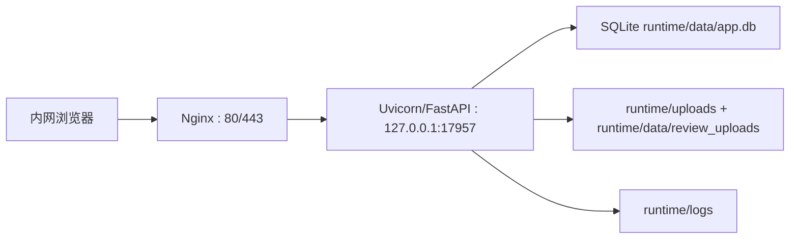
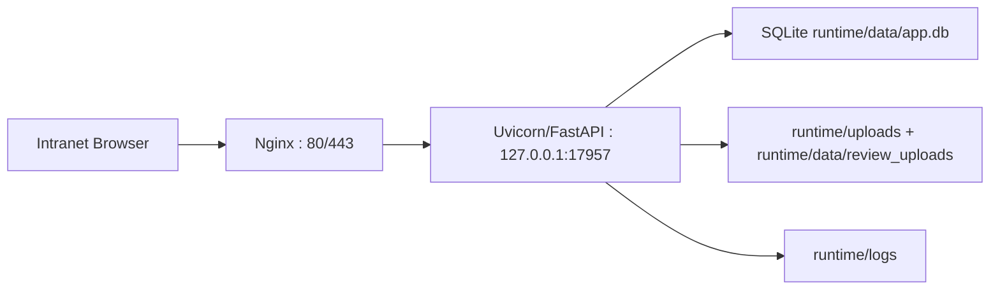

# 部署加固指南 / Deployment Hardening

<p align="center">
	<a href="#中文"><strong>中文</strong></a>
	<span> | </span>
	<a href="#english"><strong>English</strong></a>
</p>

<a id="中文"></a>

## 中文

本文讲目标服务器（以 Ubuntu 为例）上的**部署拓扑与加固操作**：Nginx 入口、systemd 守护、UFW 防火墙、目录权限。与 [打包与部署指南](packaging-and-deployment.md) 互补——那篇讲代码如何从开发机分发到服务器，本文讲服务器上的网络拓扑与加固。

> 安全改造的**设计思路与决策记录**见 `design/3-plan/安全加固方案.md`；基于代码实证的**权限与安全模型**见 [安全与权限](security.md)。

### 1. 推荐架构

采用四层结构，外部不直接接触应用进程：

1. 浏览器访问 **Nginx** 入口（80/443 或内网自定义端口）
2. Nginx 负责入口流量管理、网段控制、请求大小限制、安全响应头、访问日志治理、反向代理
3. **FastAPI/Uvicorn 只监听本机回环地址**（127.0.0.1:17957），处理业务逻辑
4. **systemd** 负责进程保活，**UFW** 负责主机层入站流量限制



**为什么不裸暴露 Uvicorn**：直接让 Uvicorn 监听 `0.0.0.0` 并暴露到内网，存在业务端口直暴、无入口访问控制、无统一安全头与请求限额、不利后续接 HTTPS 等问题。Nginx 在本项目里不是装饰层，而是入口治理层。

### 2. 系统账户与目录布局

创建专用系统用户（如 `prd-review`），**不使用 root 运行服务**：

- 服务运行用户/组：`prd-review`
- 项目部署目录：`/opt/prd-review/app`
- 运行时目录：`/opt/prd-review/runtime`
- 环境变量文件：`/etc/prd-review/prd-review.env`

```text
/opt/prd-review/
├── app/                 # 代码目录（git checkout 或发布包）
├── runtime/
│   ├── data/            # app.db、converted/、review_uploads/
│   ├── uploads/
│   └── logs/
└── venv/

/etc/prd-review/
└── prd-review.env       # JWT_SECRET 等敏感变量
```

**权限建议**：

| 路径 | 权限 |
|------|------|
| `/etc/prd-review/prd-review.env` | `600` |
| `/opt/prd-review/runtime` | `750` |
| `runtime/logs`、`runtime/data` | `750` |
| `app.db` | `640` 或更严 |
| 服务进程 `umask` | `027` |

目标：只有服务用户可写运行时数据；其他本机用户不可读敏感环境变量；日志/上传/数据库不因默认权限过宽而暴露。

### 3. Uvicorn 运行方式

Uvicorn 只监听本机回环，保持单实例、单应用进程（`--workers 1`）。上下文激活锁、审查启动锁和后台任务在进程内维护，多个 worker 或多个实例共享 SQLite/LanceDB 尚未支持：

```bash
/opt/prd-review/venv/bin/uvicorn src.main:app \
  --host 127.0.0.1 \
  --port 17957 \
  --workers 1
```

外部所有访问都必须经过 Nginx，17957 端口不对外开放。

### 4. systemd service 配置

新建 `/etc/systemd/system/prd-review.service`：

```ini
[Unit]
Description=PRD Review Web App
After=network.target
Wants=network.target

[Service]
Type=simple
User=prd-review
Group=prd-review
WorkingDirectory=/opt/prd-review/app
EnvironmentFile=/etc/prd-review/prd-review.env
Environment=PYTHONPATH=src
Environment=RUNTIME_ROOT=/opt/prd-review/runtime
UMask=0027
ExecStart=/opt/prd-review/venv/bin/uvicorn src.main:app --host 127.0.0.1 --port 17957 --workers 1
Restart=always
RestartSec=5
TimeoutStopSec=20
NoNewPrivileges=true
PrivateTmp=true
ProtectSystem=full
ProtectHome=true
ReadWritePaths=/opt/prd-review/runtime

[Install]
WantedBy=multi-user.target
```

要点：
- `EnvironmentFile` 存放 `JWT_SECRET` 等敏感变量，避免密钥落在命令行参数中。直接运行 uvicorn 时应在该文件显式设置至少 32 字符的稳定随机密钥；`start.sh` 的首次生成及持久化步骤不会在此执行
- `UMask=0027` 控制新建文件默认权限
- `ReadWritePaths` 声明 runtime 可写路径；`ProtectSystem=full` 不会把 `/opt` 整体设为只读，代码目录仍需通过属主和文件权限限制服务用户写入（见 [systemd 官方说明](https://github.com/systemd/systemd/blob/main/man/systemd.exec.xml)）
- `NoNewPrivileges=true` 减少提权面

启用：`sudo systemctl daemon-reload && sudo systemctl enable --now prd-review`


### 4.1 systemd 实例更新与回滚

该 unit 直接运行 uvicorn，所有启停均由 `systemctl` 管理。`start.sh` 使用自己的 PID 文件并后台启动进程，`update.sh` 会自行调用它；两套托管方式不能混用。即便已执行 `systemctl stop`，随后直接运行 `update.sh` 也会另外启动脚本实例。

按下面流程手动发布。先执行 `sudo -i` 进入具有 root 权限的 Bash 会话；以下命令在该会话中执行，路径与上方 unit 一致；若部署目录、用户、端口或环境文件不同，先同步修改命令。维护窗口内暂停外部业务写入，直至健康检查和业务验收完成。准备足够空间保存应用、虚拟环境及完整运行时数据。只使用经 `package.sh` 自检、来自可信发布渠道的平铺 tar.gz 包。

1. 先解包检查，再停服和备份。备份失败时重新启动原 unit，保留错误输出。

```bash
set -euo pipefail
release_package=/tmp/prd-draft-review-workflow-v1-code-config-v0.3.19-buildXXXX.tar.gz
# 将上面的包路径替换为实际文件；Pi Agent 已启用时设为 true。
use_pi_agent=false
deploy_root=/opt/prd-review
app_dir="$deploy_root/app"
service_env=/etc/prd-review/prd-review.env
release_stage=$(mktemp -d "$deploy_root/.systemd-release.XXXXXX")
backup_dir=$(mktemp -d "$deploy_root/systemd-backup.XXXXXX")
printf 'Backup directory: %s\n' "$backup_dir"
tar -xzf "$release_package" -C "$release_stage"
test -f "$release_stage/src/main.py"
test -f "$release_stage/VERSION"
test -f "$release_stage/requirements.txt"
test ! -e "$release_stage/.env"
test ! -e "$release_stage/src/.env"
expected_version=$(cat "$release_stage/VERSION")
systemctl stop prd-review
test "$(systemctl show prd-review -p MainPID --value)" = 0
if ! (umask 077
  tar -czf "$backup_dir/deployment.tar.gz" -C "$deploy_root" app venv runtime &&
  cp -p "$service_env" "$backup_dir/service.env"
); then
  systemctl start prd-review
  exit 1
fi
```

2. 构建候选代码目录，保留本机文件和环境配置，再替换代码。整个步骤保持停服；任何命令失败时停止执行，转到下方恢复流程。备份目录保留原代码和依赖，供失败时恢复。

```bash
candidate_app=$(mktemp -d "$deploy_root/.systemd-candidate.XXXXXX")
cp -a "$app_dir/." "$candidate_app/"
python3 - "$app_dir" "$candidate_app" <<'PY_PERMISSIONS'
import os
import stat
import sys
metadata = os.stat(sys.argv[1])
os.chown(sys.argv[2], metadata.st_uid, metadata.st_gid)
os.chmod(sys.argv[2], stat.S_IMODE(metadata.st_mode))
PY_PERMISSIONS
for item in src tools tests docs skills; do
  if [ -d "$release_stage/$item" ]; then
    rm -rf "$candidate_app/$item"
    cp -a "$release_stage/$item" "$candidate_app/$item"
  fi
done
for item in VERSION start.sh update.sh requirements.txt pyproject.toml package.json package-lock.json .env.example README.md CLAUDE.md LICENSE; do
  if [ -f "$release_stage/$item" ]; then
    cp -p "$release_stage/$item" "$candidate_app/$item"
  fi
done
mv "$app_dir" "$backup_dir/app-before-update"
mv "$candidate_app" "$app_dir"
/opt/prd-review/venv/bin/python -m pip install -r "$app_dir/requirements.txt"
if [ "$use_pi_agent" = true ]; then
  (cd "$app_dir" && npm ci)
fi
systemctl start prd-review
systemctl is-active --quiet prd-review
curl -fsS --retry 10 --retry-connrefused --retry-delay 1 --max-time 5   http://127.0.0.1:17957/api/health | /opt/prd-review/venv/bin/python -c   'import json,sys; d=json.load(sys.stdin); sys.exit(0 if d.get("status")=="ok" and d.get("version")==sys.argv[1] else 1)' "$expected_version"
```

systemd 继续使用 unit 中的 `RUNTIME_ROOT=/opt/prd-review/runtime` 和 `EnvironmentFile=/etc/prd-review/prd-review.env`。本流程不复制包内 runtime 模板覆盖现有配置，也不自动执行品牌迁移 apply；如需迁移，先在旧代码尚在时生成 scan/plan 报告，再按发布说明处理。Pi Agent 要求 Node.js 24.x（至少 24.22.1）；服务用户的 `PATH` 必须能找到该 Node，Pi CLI 由桥接优先从 `app/node_modules/.bin/pi` 读取。nvm 的交互式 shell 初始化不会自动进入 systemd，可在 unit 中显式配置安装位置对应的 `Environment=PATH=...`。

3. 替换、依赖安装、启动或健康检查失败时，保持维护窗口，按下面步骤恢复。新开 `sudo -i` root Bash 会话后，将 `backup_dir` 填为第 1 步实际打印的目录。先完整解包校验，再移动现有目录，失败材料保留在 `failed_dir`。若任何恢复命令失败，保持停服，保留备份、恢复目录和失败材料，检查错误后人工继续。

```bash
set -euo pipefail
deploy_root=/opt/prd-review
backup_dir=/opt/prd-review/systemd-backup.XXXXXX
service_env=/etc/prd-review/prd-review.env
recovery_stage=$(mktemp -d "$deploy_root/.systemd-recovery.XXXXXX")
tar -xzf "$backup_dir/deployment.tar.gz" -C "$recovery_stage"
test -f "$recovery_stage/app/src/main.py"
test -f "$recovery_stage/app/VERSION"
test -d "$recovery_stage/venv"
test -d "$recovery_stage/runtime"
test -f "$backup_dir/service.env"
systemctl stop prd-review
test "$(systemctl show prd-review -p MainPID --value)" = 0
failed_dir=$(mktemp -d "$deploy_root/systemd-failed.XXXXXX")
printf 'Retained deployment: %s\n' "$failed_dir"
for item in app venv runtime; do
  if [ -e "$deploy_root/$item" ]; then
    mv "$deploy_root/$item" "$failed_dir/$item"
  fi
  mv "$recovery_stage/$item" "$deploy_root/$item"
done
env_tmp=$(mktemp /etc/prd-review/.restore-env.XXXXXX)
install -m 600 "$backup_dir/service.env" "$env_tmp"
cmp -s "$backup_dir/service.env" "$env_tmp"
mv "$env_tmp" "$service_env"
expected_version=$(cat "$deploy_root/app/VERSION")
systemctl start prd-review
systemctl is-active --quiet prd-review
curl -fsS --retry 10 --retry-connrefused --retry-delay 1 --max-time 5   http://127.0.0.1:17957/api/health | /opt/prd-review/venv/bin/python -c   'import json,sys; d=json.load(sys.stdin); sys.exit(0 if d.get("status")=="ok" and d.get("version")==sys.argv[1] else 1)' "$expected_version"
```

运行时数据会恢复到停服备份时刻。恢复成功后完成业务验收，再恢复外部流量。`start.sh` 自动更新流程的退出码 `0/2/3` 不适用于这套手动 systemd 流程，应以命令返回值、unit 状态和目标版本健康检查共同判断结果。

### 5. Nginx 反向代理配置

新建 `/etc/nginx/sites-available/prd-review.conf`：

```nginx
server {
    listen 80;
    server_name _;

    # 仅允许指定内网段访问，按需调整
    allow 10.20.0.0/16;
    allow 192.168.10.0/24;
    deny all;

    client_max_body_size 60m;
    keepalive_timeout 30;

    # 基础安全响应头
    add_header X-Content-Type-Options nosniff always;
    add_header X-Frame-Options SAMEORIGIN always;
    add_header Referrer-Policy same-origin always;
    add_header Content-Security-Policy "default-src 'self'; img-src 'self' data: blob:; style-src 'self' 'unsafe-inline'; script-src 'self'; connect-src 'self'; frame-ancestors 'self'; base-uri 'self'; form-action 'self'" always;

    location / {
        proxy_pass http://127.0.0.1:17957;
        proxy_http_version 1.1;
        proxy_set_header Host $host;
        proxy_set_header X-Real-IP $remote_addr;
        proxy_set_header X-Forwarded-For $proxy_add_x_forwarded_for;
        proxy_set_header X-Forwarded-Proto $scheme;
        proxy_set_header Connection "";
        proxy_buffering off;
        proxy_read_timeout 3600;
    }

    # SSE 进度流显式关闭代理缓冲
    location /api/review/ {
        proxy_pass http://127.0.0.1:17957;
        proxy_http_version 1.1;
        proxy_set_header Host $host;
        proxy_set_header X-Real-IP $remote_addr;
        proxy_set_header X-Forwarded-For $proxy_add_x_forwarded_for;
        proxy_set_header X-Forwarded-Proto $scheme;
        proxy_buffering off;
        proxy_cache off;
        proxy_read_timeout 3600;
    }
}
```

启用：`sudo ln -s /etc/nginx/sites-available/prd-review.conf /etc/nginx/sites-enabled/ && sudo nginx -t && sudo systemctl reload nginx`

> **SSE 注意**：评审进度流、通知流走 SSE，必须 `proxy_buffering off`，否则流会被 Nginx 缓冲导致前端收不到实时进度。

### 6. UFW 防火墙规则

原则：对外只开放 Nginx 端口，不开放 17957，仅允许指定网段访问：

```bash
sudo ufw default deny incoming
sudo ufw default allow outgoing
sudo ufw allow from 10.20.0.0/16 to any port 80 proto tcp
sudo ufw allow from 192.168.10.0/24 to any port 80 proto tcp
sudo ufw enable
```

启用 HTTPS 时对应开放 443。

### 7. 上线检查清单

- [ ] Uvicorn 仅监听 `127.0.0.1`，外部无法直连 17957
- [ ] Nginx 网段白名单生效，未授权网段访问被拒
- [ ] `JWT_SECRET` 由 systemd EnvironmentFile 提供，重启不漂移
- [ ] 服务以专用用户 `prd-review` 运行，非 root
- [ ] runtime 目录新建文件权限符合 `umask 027` 预期
- [ ] SSE 端点经反代能正常推送实时进度
- [ ] 生产环境已评估注册策略（`allow_public_registration`）与首 admin 初始化方式

---

<a id="english"></a>

## English

This guide covers the **deployment topology and hardening operations** on the target server (using Ubuntu as an example): Nginx entry point, systemd supervision, UFW firewall, and directory permissions. It complements [Packaging and Deployment](packaging-and-deployment.md) — that one covers distributing code from the dev machine to the server, while this one covers the network topology and hardening on the server.

> The **design rationale and decision log** for security changes is in `design/3-plan/安全加固方案.md`; the **permissions and security model based on the actual code** is in [Security & Permissions](security.md).

### 1. Recommended Architecture

A four-layer structure where external traffic never touches the app process directly:

1. Browsers hit an **Nginx** entry point (80/443 or a custom intranet port)
2. Nginx handles traffic management, CIDR control, request size limits, security headers, access logs, and reverse proxying
3. **FastAPI/Uvicorn listens only on the loopback address** (127.0.0.1:17957) and handles business logic
4. **systemd** keeps the process alive; **UFW** restricts host-level inbound traffic



**Why not expose Uvicorn directly**: Letting Uvicorn listen on `0.0.0.0` and exposing it to the intranet leaves the business port wide open, with no entry-level access control, no unified security headers or request limits, and no clean path to HTTPS. Nginx here is not decoration — it is the governance layer at the edge.

### 2. System Account and Directory Layout

Create a dedicated system user (e.g. `prd-review`); **do not run the service as root**:

- Service user/group: `prd-review`
- Project directory: `/opt/prd-review/app`
- Runtime directory: `/opt/prd-review/runtime`
- Environment file: `/etc/prd-review/prd-review.env`

```text
/opt/prd-review/
├── app/                 # code directory (git checkout or release package)
├── runtime/
│   ├── data/            # app.db, converted/, review_uploads/
│   ├── uploads/
│   └── logs/
└── venv/

/etc/prd-review/
└── prd-review.env       # JWT_SECRET and other sensitive variables
```

**Permission recommendations**:

| Path | Mode |
|------|------|
| `/etc/prd-review/prd-review.env` | `600` |
| `/opt/prd-review/runtime` | `750` |
| `runtime/logs`, `runtime/data` | `750` |
| `app.db` | `640` or stricter |
| Service process `umask` | `027` |

Goal: only the service user can write runtime data; other local users cannot read sensitive env vars; logs/uploads/database are not exposed by overly broad defaults.

### 3. Uvicorn Runtime

Uvicorn listens only on loopback, with one instance and one application process (`--workers 1`). Context activation locks, review-start locks, and background tasks are maintained in memory. Multiple workers or instances sharing SQLite/LanceDB are not supported yet:

```bash
/opt/prd-review/venv/bin/uvicorn src.main:app \
  --host 127.0.0.1 \
  --port 17957 \
  --workers 1
```

All external access must go through Nginx; port 17957 is never opened externally.

### 4. systemd Service

Create `/etc/systemd/system/prd-review.service`:

```ini
[Unit]
Description=PRD Review Web App
After=network.target
Wants=network.target

[Service]
Type=simple
User=prd-review
Group=prd-review
WorkingDirectory=/opt/prd-review/app
EnvironmentFile=/etc/prd-review/prd-review.env
Environment=PYTHONPATH=src
Environment=RUNTIME_ROOT=/opt/prd-review/runtime
UMask=0027
ExecStart=/opt/prd-review/venv/bin/uvicorn src.main:app --host 127.0.0.1 --port 17957 --workers 1
Restart=always
RestartSec=5
TimeoutStopSec=20
NoNewPrivileges=true
PrivateTmp=true
ProtectSystem=full
ProtectHome=true
ReadWritePaths=/opt/prd-review/runtime

[Install]
WantedBy=multi-user.target
```

Key points:
- `EnvironmentFile` stores `JWT_SECRET` and other sensitive variables, keeping secrets out of command-line arguments. Set a stable random secret of at least 32 characters there when running uvicorn directly; this path does not execute the first-start generation and persistence performed by `start.sh`
- `UMask=0027` controls default permissions of new files
- `ReadWritePaths` declares the runtime write path. `ProtectSystem=full` does not make all of `/opt` read-only; use ownership and file permissions to restrict service-user writes to code (see the [official systemd documentation](https://github.com/systemd/systemd/blob/main/man/systemd.exec.xml))
- `NoNewPrivileges=true` reduces privilege-escalation surface

Enable: `sudo systemctl daemon-reload && sudo systemctl enable --now prd-review`


### 4.1 systemd Updates and Rollback

This unit runs uvicorn directly, and `systemctl` owns its lifecycle. `start.sh` tracks its own PID and starts a background process; `update.sh` invokes that script. Use one supervisor per instance. Running `update.sh` after `systemctl stop` would still launch a separate script-managed process.

Deploy manually using the procedure below. Run `sudo -i` to enter a root Bash session, then execute the commands there. Paths match the unit above; adjust them first if your deployment directory, service user, port, or environment file differs. Pause external business writes throughout the maintenance window until health checks and acceptance finish. Allow enough space for the application, virtual environment, and complete runtime snapshot. Use only a trusted, flat tar.gz release that passed `package.sh` self-checks.

1. Extract and check the release before stopping the service and taking a backup. If backup fails, restart the original unit and retain the error output.

```bash
set -euo pipefail
release_package=/tmp/prd-draft-review-workflow-v1-code-config-v0.3.19-buildXXXX.tar.gz
# Replace the package path; set this to true when Pi Agent is enabled.
use_pi_agent=false
deploy_root=/opt/prd-review
app_dir="$deploy_root/app"
service_env=/etc/prd-review/prd-review.env
release_stage=$(mktemp -d "$deploy_root/.systemd-release.XXXXXX")
backup_dir=$(mktemp -d "$deploy_root/systemd-backup.XXXXXX")
printf 'Backup directory: %s\n' "$backup_dir"
tar -xzf "$release_package" -C "$release_stage"
test -f "$release_stage/src/main.py"
test -f "$release_stage/VERSION"
test -f "$release_stage/requirements.txt"
test ! -e "$release_stage/.env"
test ! -e "$release_stage/src/.env"
expected_version=$(cat "$release_stage/VERSION")
systemctl stop prd-review
test "$(systemctl show prd-review -p MainPID --value)" = 0
if ! (umask 077
  tar -czf "$backup_dir/deployment.tar.gz" -C "$deploy_root" app venv runtime &&
  cp -p "$service_env" "$backup_dir/service.env"
); then
  systemctl start prd-review
  exit 1
fi
```

2. Build a candidate application directory, retaining local files and environment configuration, then replace the code. Keep the unit stopped throughout this step. If any command fails, stop and use the recovery procedure below. The backup directory retains the original code and dependencies.

```bash
candidate_app=$(mktemp -d "$deploy_root/.systemd-candidate.XXXXXX")
cp -a "$app_dir/." "$candidate_app/"
python3 - "$app_dir" "$candidate_app" <<'PY_PERMISSIONS'
import os
import stat
import sys
metadata = os.stat(sys.argv[1])
os.chown(sys.argv[2], metadata.st_uid, metadata.st_gid)
os.chmod(sys.argv[2], stat.S_IMODE(metadata.st_mode))
PY_PERMISSIONS
for item in src tools tests docs skills; do
  if [ -d "$release_stage/$item" ]; then
    rm -rf "$candidate_app/$item"
    cp -a "$release_stage/$item" "$candidate_app/$item"
  fi
done
for item in VERSION start.sh update.sh requirements.txt pyproject.toml package.json package-lock.json .env.example README.md CLAUDE.md LICENSE; do
  if [ -f "$release_stage/$item" ]; then
    cp -p "$release_stage/$item" "$candidate_app/$item"
  fi
done
mv "$app_dir" "$backup_dir/app-before-update"
mv "$candidate_app" "$app_dir"
/opt/prd-review/venv/bin/python -m pip install -r "$app_dir/requirements.txt"
if [ "$use_pi_agent" = true ]; then
  (cd "$app_dir" && npm ci)
fi
systemctl start prd-review
systemctl is-active --quiet prd-review
curl -fsS --retry 10 --retry-connrefused --retry-delay 1 --max-time 5   http://127.0.0.1:17957/api/health | /opt/prd-review/venv/bin/python -c   'import json,sys; d=json.load(sys.stdin); sys.exit(0 if d.get("status")=="ok" and d.get("version")==sys.argv[1] else 1)' "$expected_version"
```

systemd keeps using `RUNTIME_ROOT=/opt/prd-review/runtime` and `EnvironmentFile=/etc/prd-review/prd-review.env` from the unit. This procedure preserves existing runtime configuration and leaves branding migration apply as a separate action. If migration is needed, generate scan/plan reports while the old code is still available, then follow the release instructions. Pi Agent requires Node.js 24.x, at least 24.22.1; the service user's `PATH` must resolve that Node installation. The bridge prefers the local CLI at `app/node_modules/.bin/pi`. Interactive nvm initialization is not inherited by systemd; explicitly set `Environment=PATH=...` in the unit for your installation when needed.

3. If replacement, dependency installation, startup, or health checks fail, keep the maintenance window in place and restore as follows. In a fresh root Bash session opened with `sudo -i`, set `backup_dir` to the directory printed in step 1. Extract and check the full backup before moving current directories. `failed_dir` retains the failed deployment. If any recovery command fails, keep the unit stopped and retain the backup, recovery directory, and failed deployment while resolving the error manually.

```bash
set -euo pipefail
deploy_root=/opt/prd-review
backup_dir=/opt/prd-review/systemd-backup.XXXXXX
service_env=/etc/prd-review/prd-review.env
recovery_stage=$(mktemp -d "$deploy_root/.systemd-recovery.XXXXXX")
tar -xzf "$backup_dir/deployment.tar.gz" -C "$recovery_stage"
test -f "$recovery_stage/app/src/main.py"
test -f "$recovery_stage/app/VERSION"
test -d "$recovery_stage/venv"
test -d "$recovery_stage/runtime"
test -f "$backup_dir/service.env"
systemctl stop prd-review
test "$(systemctl show prd-review -p MainPID --value)" = 0
failed_dir=$(mktemp -d "$deploy_root/systemd-failed.XXXXXX")
printf 'Retained deployment: %s\n' "$failed_dir"
for item in app venv runtime; do
  if [ -e "$deploy_root/$item" ]; then
    mv "$deploy_root/$item" "$failed_dir/$item"
  fi
  mv "$recovery_stage/$item" "$deploy_root/$item"
done
env_tmp=$(mktemp /etc/prd-review/.restore-env.XXXXXX)
install -m 600 "$backup_dir/service.env" "$env_tmp"
cmp -s "$backup_dir/service.env" "$env_tmp"
mv "$env_tmp" "$service_env"
expected_version=$(cat "$deploy_root/app/VERSION")
systemctl start prd-review
systemctl is-active --quiet prd-review
curl -fsS --retry 10 --retry-connrefused --retry-delay 1 --max-time 5   http://127.0.0.1:17957/api/health | /opt/prd-review/venv/bin/python -c   'import json,sys; d=json.load(sys.stdin); sys.exit(0 if d.get("status")=="ok" and d.get("version")==sys.argv[1] else 1)' "$expected_version"
```

Runtime data returns to the stopped-service backup snapshot. Complete business acceptance before restoring external traffic. Exit codes `0/2/3` from the `start.sh`-managed automated updater do not apply to this manual systemd procedure; assess command results, unit state, and the target-version health check together.

### 5. Nginx Reverse Proxy

Create `/etc/nginx/sites-available/prd-review.conf`:

```nginx
server {
    listen 80;
    server_name _;

    # Allow only specified intranet CIDRs; adjust as needed
    allow 10.20.0.0/16;
    allow 192.168.10.0/24;
    deny all;

    client_max_body_size 60m;
    keepalive_timeout 30;

    # Basic security headers
    add_header X-Content-Type-Options nosniff always;
    add_header X-Frame-Options SAMEORIGIN always;
    add_header Referrer-Policy same-origin always;
    add_header Content-Security-Policy "default-src 'self'; img-src 'self' data: blob:; style-src 'self' 'unsafe-inline'; script-src 'self'; connect-src 'self'; frame-ancestors 'self'; base-uri 'self'; form-action 'self'" always;

    location / {
        proxy_pass http://127.0.0.1:17957;
        proxy_http_version 1.1;
        proxy_set_header Host $host;
        proxy_set_header X-Real-IP $remote_addr;
        proxy_set_header X-Forwarded-For $proxy_add_x_forwarded_for;
        proxy_set_header X-Forwarded-Proto $scheme;
        proxy_set_header Connection "";
        proxy_buffering off;
        proxy_read_timeout 3600;
    }

    # Explicitly disable proxy buffering for SSE progress streams
    location /api/review/ {
        proxy_pass http://127.0.0.1:17957;
        proxy_http_version 1.1;
        proxy_set_header Host $host;
        proxy_set_header X-Real-IP $remote_addr;
        proxy_set_header X-Forwarded-For $proxy_add_x_forwarded_for;
        proxy_set_header X-Forwarded-Proto $scheme;
        proxy_buffering off;
        proxy_cache off;
        proxy_read_timeout 3600;
    }
}
```

Enable: `sudo ln -s /etc/nginx/sites-available/prd-review.conf /etc/nginx/sites-enabled/ && sudo nginx -t && sudo systemctl reload nginx`

> **SSE note**: review progress streams and notification streams use SSE; `proxy_buffering off` is mandatory, otherwise Nginx buffers the stream and the frontend never receives real-time progress.

### 6. UFW Firewall Rules

Principle: open only the Nginx port externally, never 17957, and allow only specified CIDRs:

```bash
sudo ufw default deny incoming
sudo ufw default allow outgoing
sudo ufw allow from 10.20.0.0/16 to any port 80 proto tcp
sudo ufw allow from 192.168.10.0/24 to any port 80 proto tcp
sudo ufw enable
```

Open 443 when enabling HTTPS.

### 7. Go-Live Checklist

- [ ] Uvicorn listens only on `127.0.0.1`; 17957 is not directly reachable externally
- [ ] Nginx CIDR whitelist is active; unauthorized CIDRs are rejected
- [ ] `JWT_SECRET` is provided via systemd EnvironmentFile and survives restarts
- [ ] The service runs as the dedicated `prd-review` user, not root
- [ ] New files under runtime match the `umask 027` expectation
- [ ] SSE endpoints push real-time progress correctly through the proxy
- [ ] Registration policy (`allow_public_registration`) and first-admin bootstrap have been evaluated for production
